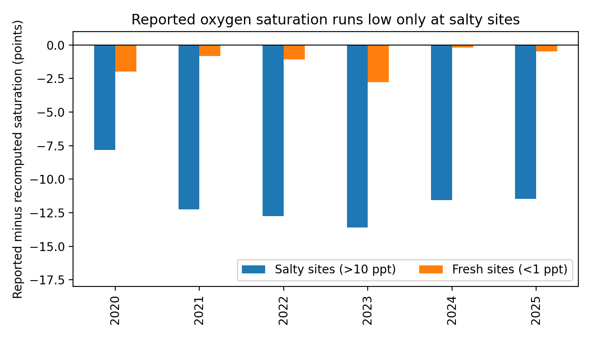

# East River Water Quality

Student-collected water-quality data from the Hudson River estuary are often reported as percent oxygen saturation using a freshwater chart. Across six years of *A Day in the Life of the Hudson & Harbor* data (2020–2025), that chart puts readings from salty sites 8 to 14 points below their salinity-corrected value every year, while freshwater sites match. The program's own guide notes that the chart ignores salinity; this repository measures how much that matters.

## Why this project
On October 6, I waited for the precipitate in my sample bottle to settle before adding the third reagent to measure dissolved oxygen. The saturation chart assumes warmer water holds less oxygen, but the sun that warms the river also feeds algae that produce more. Which push moves the reading? Then the salinity meters disagreed: same spot, minutes apart. Before asking what drives dissolved oxygen, I had to know which readings to trust. This repository starts there.

## Questions
1. How much do salinity readings taken at the same site disagree, and why?
2. Relative to saturation, how much dissolved oxygen did the water hold once salinity is taken into account?
3. Does the same saturation issue appear across the whole program, and in every year?
4. How does dissolved oxygen depend on temperature and salinity, and does that match what oxygen solubility predicts?

## Data
`data/ditl_2026-10-06_east_river.csv`: 18 measurements (6 groups × 3 trials) of salinity, water temperature, pH, turbidity, and dissolved oxygen, taken at one East River site on October 6, 2026, between 10:34 and 12:30. Group names are replaced with letters A–F. Values are transcribed as recorded; only formats were standardized (units removed, times written as HH:MM).

`data/estuary_2020_2025.csv`: Lamont-Doherty Earth Observatory's compiled Day in the Life data for 2020–2025, combined by `notebooks/04_estuary_2020_2025.ipynb` from the public spreadsheets (486 site records). Salinity is matched to each site by river and river mile.

## Findings
**Salinity** ([notebook](notebooks/01_salinity_by_group.ipynb)): Readings within a group mostly agree, but groups fall into two levels, about 26 ppt and 28–29 ppt. Groups B and F measured back to back yet differ by 2–3 ppt, which points to the meters or how they were read rather than the water itself. One reading (36 ppt) is saltier than the open ocean and was treated as an outlier.

**Dissolved oxygen, my class** ([notebook](notebooks/02_dissolved_oxygen.ipynb)): The saturation values the groups reported match a freshwater saturation table. Correcting for salinity raises saturation by about 15 percentage points, to roughly 100–117%; given the test kit's whole-number resolution, the water was approximately saturated.

**Estuary-wide, 2020–2025** ([2025 notebook](notebooks/03_estuary_2025.ipynb), [six-year notebook](notebooks/04_estuary_2020_2025.ipynb)): At salty sites (above 10 ppt), 73 of 100 reported values fall within 5 points of a freshwater calculation. Against the salinity-corrected value, they run low every year, by a median of 7.8 to 13.6 points. At freshwater sites (below 1 ppt, 65 readings), the median gap is 0.2 to 2.8 points.

**What drives dissolved oxygen** ([notebook](notebooks/05_oxygen_regression.ipynb)): Holding temperature fixed, dissolved oxygen falls 0.055 ppm per ppt of salinity (95% CI −0.080 to −0.031), close to the 0.053 that oxygen solubility predicts. On average the water was about 93% saturated. With the freshwater chart, saturation appears to fall with salinity, as if salty water were more oxygen-starved; with the salinity-corrected calculation, that trend disappears (−0.02 points per ppt, 95% CI −0.30 to +0.25).

## Limitations
- My class's data: one site on one day; some values appear to be shared across groups, so the 18 readings are not all independent. With this data alone, measurement error cannot be separated from tidal change.
- Estuary-wide data: collected by many student groups with different equipment; salinity is matched by river mile rather than measured alongside each oxygen reading; three river miles are parsed incorrectly (none at a salty site).
- The regression explains about 10% of the variation (R² = 0.098). The temperature effect is weaker than solubility predicts, likely because each sampling day covers a narrow temperature range. Year-by-year coefficients vary widely, and salty sites cluster near the harbor, so salinity may stand in for other site differences.
- Most salinity meters and DO kits read only whole numbers.

## Next steps
- Share the salinity correction with my teacher and the program organizers.
- Add year-round NYC DEP Harbor Water Quality data to test the temperature effect over a wider range.

## References
- Weiss, R. F. (1970). The solubility of nitrogen, oxygen and argon in water and seawater. *Deep-Sea Research*, 17, 721–735.
- Lamont-Doherty Earth Observatory, *A Day in the Life of the Hudson & Harbor*, compiled data, 2020–2025.
- Lamont-Doherty Earth Observatory, [*Interpreting Your Data* (answer key)](https://www.ldeo.columbia.edu/edu/k12/snapshotday/activities/InterpretingYourDataANS.pdf).
